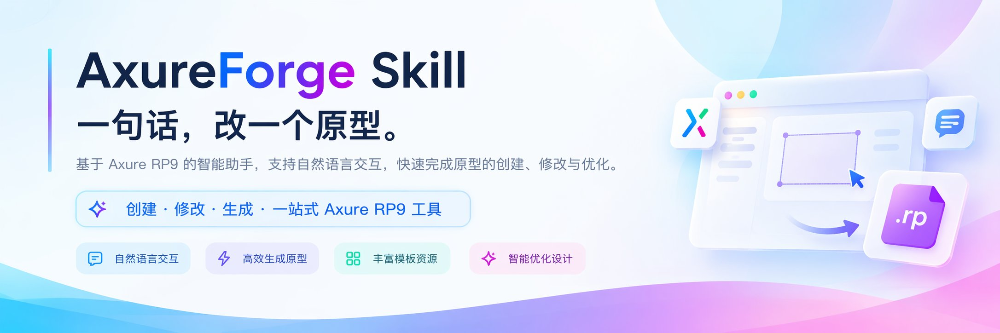

<p align="center">
  <b>English</b> · <a href="README.zh-CN.md">简体中文</a>
</p>

<p align="center">
  
</p>

<h1 align="center">AxureForge Skill</h1>

<p align="center"><b>Describe the change. Get the prototype.</b></p>
<p align="center">
  Analyze, create and edit Axure RP9 / RP11 prototypes in plain language.<br>
  No commands to memorize. No file format to learn.
</p>

<p align="center">
  
  
  
</p>

<p align="center">
  
  
  
  
</p>

<p align="center">
  <a href="#what-it-does">What it does</a> ·
  <a href="#how-it-works">How it works</a> ·
  <a href="#install">Install</a> ·
  <a href="#usage">Usage</a> ·
  <a href="#advanced-options">Advanced options</a> ·
  <a href="#faq">FAQ</a>
</p>

## What it does

- 🔍 **Understand existing prototypes** — one pass tells you which pages exist, what widgets each page has, and which interactions are wired.
- 🧱 **Build pages from scratch** — agree the canvas first, then generate the skeleton: page scope, target device, width, first-screen height, and fixed vs. vertically extending.
- 🌐 **Web page to prototype** — read an existing web page into an editable RP file, saved as a new file.
- ✏️ **Batch text edits** — for example, change every "Submit" to "Confirm submit" in one pass; if anything fails, nothing is left behind.
- 👆 **Wire interactions** — attach actions such as "click to switch panel state" to a button, and say exactly which widget they live on.
- 🔄 **Strict RP9 ↔ RP11 conversion** — preflight first, then convert; when a capability is missing it tells you honestly instead of converting implicitly.
- ✅ **Generate and validate without the editor** — once installed you can create files and inspect structure and properties; only visual acceptance needs Axure open.

## How it works

The whole flow takes four steps. It handles everything in between.

1. **You describe what you need** — one sentence is enough.
2. **Agree the pages and canvas** — when creating or heavily redesigning, confirm page scope, target device, canvas width, first-screen height, and fixed vs. vertically extending in one go; reuse an existing agreement as-is.
3. **Generate or modify the .rp** — you can start from a built-in template; AxureForge computes the layout and produces a plan, an index, and a report as evidence.
4. **You open it in Axure to check** — look at the result, and if it isn't right, just keep talking.

## Before you start

- Installing and generating do not require the Axure editor.
- Only native visual acceptance needs the matching RP9/RP11 editor open.
- No separate runtime is needed; once installed, it works.

Current skill version 0.5.0, protocol v3, requires CLI 0.5.0 or later.

## Install

The first command only lists what is in this repository:

```bash
npx skills add qizhi2design/axure-forge-skill --list
```

The second installs AxureForge into your AI assistant:

```bash
npx skills add qizhi2design/axure-forge-skill --skill axure-forge --agent codex --global
```

Installation uses the `npx` command. If it is not found, install npm once (the npm website has installers) and come back.
The required program is downloaded from a public page ([axureforge-cli](https://github.com/qizhi2design/axureforge-cli)); no login needed.

Once installed, invoke it in your AI assistant with `$axure-forge`.

## Usage

Just describe what you need in plain language — no commands to memorize.

| You say | What it does |
| --- | --- |
| `$axure-forge 检查 RP9 环境` | Confirms whether the local Axure RP9 can work with it, and says directly what is missing. |
| `$axure-forge 分析 ./demo.rp 的页面和交互` | Lists the pages, the widgets on each page, and the interactions wired to them. |
| `$axure-forge 将 ./site 转换为 ./demo.rp` | Reads a web folder into an editable prototype, saved as a new file. |
| `$axure-forge 将 ./demo.rp 中「提交」改为「确认提交」，另存为 ./edited.rp` | Finds where the text lives, makes the change, and saves as a new file, leaving the original untouched. |
| `$axure-forge 创建两个状态的面板，并为按钮添加切换交互` | Creates a two-state panel and wires the button to "click to switch state". |
| `$axure-forge 把 ./demo.rp 转成 RP11，另存为 ./demo-rp11.rp` | Preflights compatibility first, then converts strictly and saves as new; the original is untouched. |
| `$axure-forge 用桌面看板模板起一个 1440 宽的原型` | Starts from the dashboard template and generates a new prototype on the agreed canvas. |

On first use it sniffs the RP9/RP11 environment and checks protocol v3 capabilities, then prepares the required programs. Anything already installed at a suitable version is reused.

## Advanced options

<details>
<summary><b>Canvas agreement: when to confirm, when to reuse</b></summary>

When creating a prototype, adding a standalone page, or significantly changing the layout, agree the canvas first.
Confirm these in one go: page scope, target device, canvas width, first-screen height, and fixed vs. vertically extending.

When you are only changing text, widget properties, or interactions, reuse the existing layout and do not re-confirm.
Specs already confirmed in this conversation or project are reused as-is.

When information is insufficient it offers concrete suggestions first and asks you to confirm once; it does not start before you confirm.
The CLI's default dimensions do not count as dimensions you have confirmed.

The agreement is recorded in `design-brief.md` in the working directory (under `.forge/` by default).

</details>

<details>
<summary><b>Starter templates: 3 built-ins</b></summary>

| Template | Size | Sections |
| --- | --- | --- |
| Desktop dashboard | 1440×900 | Sidebar, key metrics, task list, source breakdown |
| Desktop list and form | 1440×900 | Filters, data table, edit form |
| Mobile detail | 390×844 | Header, detail card, follow-up records, bottom actions |

All three templates extend vertically by default, so content grows downward past the first screen.
A template is only a starting point, not a confirmed requirement; which one you use and how you change it follow your canvas agreement.

</details>

<details>
<summary><b>Evidence and index: .forge, dump, batch</b></summary>

The working directory is `.forge/` by default; use `--work-dir` to put it elsewhere.
Each time, read `summary.json` in it first; only dig into reports or indexes when something goes wrong.

`dump` fully parses a project once and builds an index, so later queries run locally without pouring all node data into the conversation.

`batch` is an atomic commit: it writes everything at once and rolls back as a whole on failure, keeping no partial edits.
Newly generated widgets can be referenced from the previous step's result for the next change.

</details>

<details>
<summary><b>Version choice and updates</b></summary>

The default version for new files is decided in this order: what you specify explicitly → the agreement already confirmed for this project → environment sniffing.

Sniffing rules: if only RP11 is installed, default to 11; if only RP9 is installed, both are installed, or neither is installed, default to 9.
When both are present and the delivery target is unclear, it asks once and suggests RP9.

Existing files keep their source format by default and never switch versions quietly; conversion requires your explicit request — preflight first, then a strict conversion saved as a new file.

`doctor.sh` accepts: `--axure-path`, `--format-version 9|11`, `--app-only`, `--check-updates`.

To check for updates (run from the skill directory):

```bash
bash skills/axure-forge/scripts/doctor.sh --check-updates
```

If it is installed elsewhere, replace the directory above with the actual skill path.

The CLI's self-update entry point has not shipped yet, so upgrades go through the install script: rerun the install command above.
When it cannot determine a version it says so directly and never claims "already up to date".

More install options: [installation notes (Chinese)](skills/axure-forge/references/installation.md).

</details>

## FAQ

<details>
<summary><b>Installed, but the AI assistant doesn't respond?</b></summary>

First make sure you invoke it with `$axure-forge`. The first run sniffs the editor environment and checks the required programs, so give it a moment.

</details>

<details>
<summary><b>It says the npx command cannot be found?</b></summary>

Install npm once (the npm website has installers), then come back and run the install command again.

</details>

<details>
<summary><b>Will changes overwrite the original file?</b></summary>

By default it saves to a new file and does not overwrite your original. Overwriting requires your explicit request.

</details>

<details>
<summary><b>What if Axure is not installed in the default location?</b></summary>

Just tell it your install path. It auto-detects RP9/RP11 in Applications and also accepts a custom location.

</details>

<details>
<summary><b>Can it handle Axure RP9 files?</b></summary>

Yes. It reads, edits, and saves RP9; existing files keep their source format by default and are not quietly switched to RP11.

</details>

<details>
<summary><b>Can it handle Axure RP11 files?</b></summary>

Yes. It reads, edits, and saves RP11; when a version change is needed it preflights first, then strictly converts and saves as a new file.

</details>

<details>
<summary><b>Can I use it without installing Axure?</b></summary>

Yes. Installing, generating, modifying, and structural validation all work without the editor.
Only checking real visual results and interactions needs the matching Axure version open.

</details>

<details>
<summary><b>How do I choose between RP9 and RP11?</b></summary>

Look at the delivery target: if the team still uses RP9, choose 9. When both are available and nothing is specified, default to 9.
Existing files keep their original format by default and it will not quietly switch versions for you.

</details>

## Notes

- RP9 files can be read, edited, and saved.
- RP11 files can be read, edited, and saved.
- Existing files keep their source format by default; changing versions requires preflight then strict conversion, with no implicit conversion.
- Changes are saved to a new file by default and never overwrite your original. Overwriting requires your explicit request.
- Automated checks only validate file structure and properties. Preview interactions in Axure to confirm them for real.
- Web page to prototype is not a 100% reproduction. Scripts and complex layout in the browser may not match, so review the result yourself after converting.

## License

The AxureForge Skill is released under the MIT License; see [LICENSE](LICENSE) for the full text.
The AxureForge program shipped with it is also released under the MIT License.


## Check and update

Run `axure-forge update check` to inspect CLI and skill versions, then `axure-forge update all --dry-run` to preview and `axure-forge update all --yes` to apply. Offline use remains available; unreachable release sources leave the current installation intact. Updated skills need to be reloaded. See [update and source settings](skills/axure-forge/references/installation.md).
