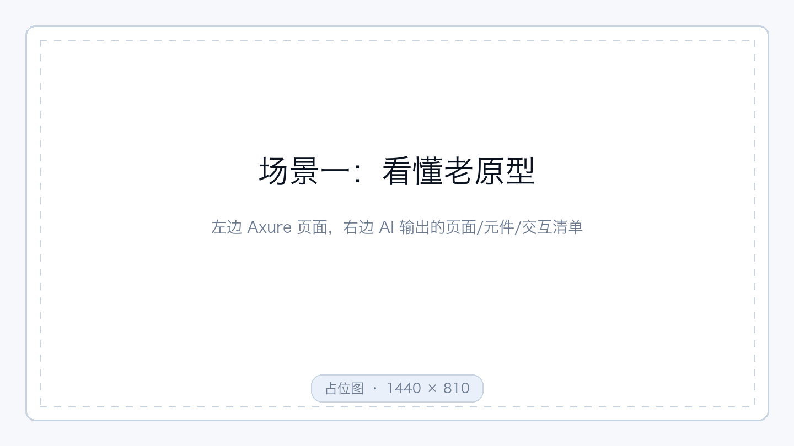
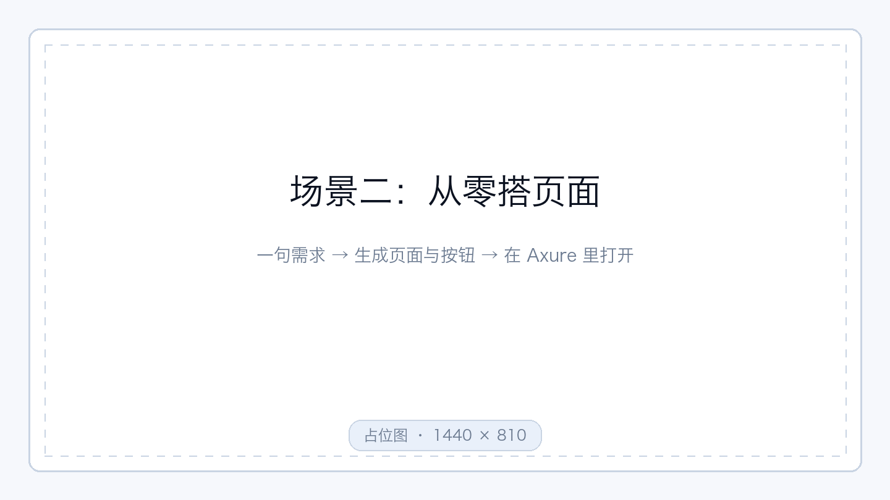
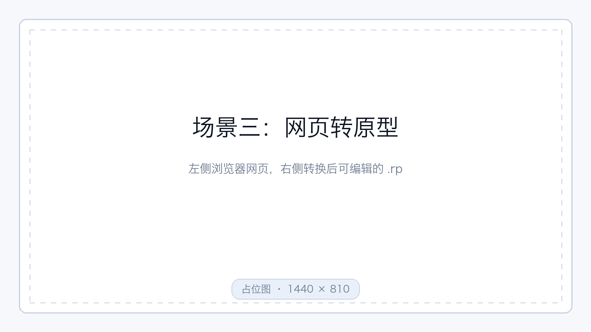
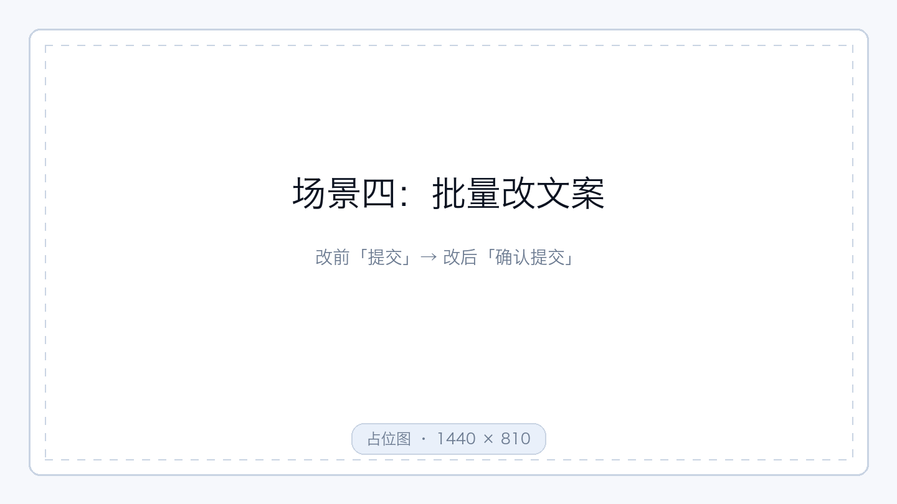
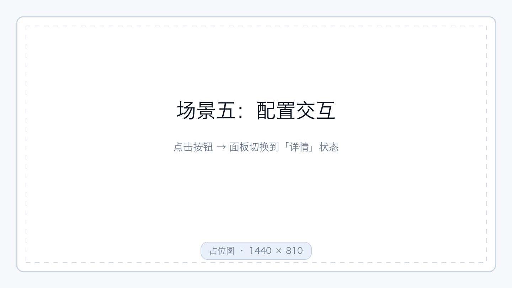
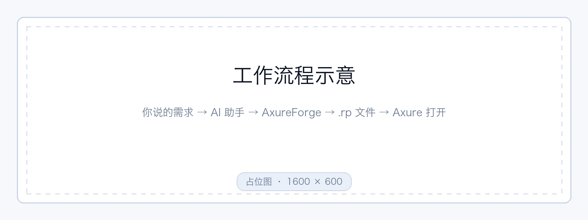

<p align="center">
  
</p>

<h1 align="center">AxureForge Skill</h1>

<p align="center"><b>说一句话，改一个原型。</b></p>
<p align="center">
  用日常语言让 AI 助手分析、新建和修改 Axure RP9 原型<br>
  不记命令，不碰文件格式。
</p>

<p align="center">
  
  
  
  
</p>

<p align="center">
  
  
  
  
</p>

<p align="center">
  <a href="#能做什么">能做什么</a> ·
  <a href="#效果">效果</a> ·
  <a href="#它是怎么工作的">它是怎么工作的</a> ·
  <a href="#安装">安装</a> ·
  <a href="#怎么用">怎么用</a> ·
  <a href="#常见问题">常见问题</a>
</p>

## 能做什么

- 🔍 看清楚一个老原型的页面结构，不用一页页点开。
- 🔗 查清某个按钮或面板上挂了什么交互。
- 🌐 把现成的网页读成可以继续编辑的原型。
- ✏️ 批量改文案，比如把页面里的「提交」统一改成「确认提交」。
- 🧱 从零建一个项目，加上页面和按钮，先有个能讲的骨架。
- 👆 给按钮配交互，比如点一下，面板切换到另一个状态。

## 效果

### 30 秒看完


*从提需求到改完回读验证，全过程不用手写命令。*

### 五个典型场景

#### 一、看懂一个老原型



*「这个原型有几个页面、每页放了什么、按钮上挂的是什么交互？」*

#### 二、从零搭一个页面



*先给一个能讲的骨架，再往里填内容。*

#### 三、把网页转成原型



*现成的网页读成可编辑原型，转化范围以实际支持能力为准。*

#### 四、批量改文案



*「把页面里的『提交』统一改成『确认提交』」，改完另存。*

#### 五、配一个交互



*点一下，面板切到另一个状态。*

## 它是怎么工作的



*四步，中间的事它来做。*

1. **你提需求** —— 用中文说一句就行。
2. **AI 读技能说明** —— 知道该按什么步骤做。
3. **AxureForge 生成或修改 .rp** —— 页面、元件、交互都在这一步落地。
4. **你在 Axure 里打开验收** —— 看效果，不满意就接着说。

## 使用前准备

- 一台 Apple 芯片的 Mac（M 系列芯片）。
- 电脑上已经装好 Axure RP9。
- 不需要另外安装运行环境，AxureForge 装好就能用。

## 安装

第一条命令只是看看这个仓库里有什么：

```bash
npx skills add qizhi2design/axure-forge-skill --list
```

第二条命令把 AxureForge 装到你的 AI 助手里：

```bash
npx skills add qizhi2design/axure-forge-skill --skill axure-forge --agent codex --global
```

安装会用到 `npx` 命令。如果提示找不到这个命令，先装一次 npm（npm 官网有安装包）再回来。
所需的程序从公开下载页获取（[axureforge-cli](https://github.com/qizhi2design/axureforge-cli)），不需要登录。

装好以后，在 AI 助手里用 `$axure-forge` 就能唤起它。

## 怎么用

直接用中文说需求就行，不用记命令。

| 你说的话 | 它会做什么 |
| --- | --- |
| `$axure-forge 检查 RP9 环境` | 确认本机的 Axure RP9 能不能配合工作，缺什么会直接说。 |
| `$axure-forge 分析 ./demo.rp 的页面和交互` | 列出有哪些页面、页面上有什么元件、挂了什么交互。 |
| `$axure-forge 将 ./site 转换为 ./demo.rp` | 把网页文件夹读成可编辑的原型，另存为新文件。 |
| `$axure-forge 将 ./demo.rp 中「提交」改为「确认提交」，另存为 ./edited.rp` | 找到文字所在位置，改完另存，原文件不动。 |
| `$axure-forge 创建两个状态的面板，并为按钮添加切换交互` | 新建两状态面板，把按钮接上「点击切换状态」。 |

第一次使用会先检查 RP9，再准备需要的程序。已经装过且版本合适的会直接复用。

## 可选设置

- Axure 没装在默认位置（默认是「应用程序」文件夹里的 Axure RP 9）：直接告诉它你的安装路径。
- 想装到别的位置：默认装在 `~/.local/bin`，也可以指定别的目录。
- 升级或覆盖：想换新版本时明确说明；不说明时继续用已经装好的。
- 离线安装：手上有安装包和校验文件（用来确认下载完整）时，可以从本地装。

更多安装选项见 skill 内的安装说明。

## 常见问题

<details>
<summary><b>装好了，但 AI 助手里没反应？</b></summary>

先确认是用 `$axure-forge` 唤起它的。第一次运行会先检查 RP9 和需要的程序，稍等一下。

</details>

<details>
<summary><b>提示找不到 npx 命令？</b></summary>

先装一次 npm（npm 官网有安装包），装好再回来跑安装命令。

</details>

<details>
<summary><b>改动会覆盖原文件吗？</b></summary>

默认另存为新文件，不会覆盖你的原文件。要覆盖必须你明确要求。

</details>

<details>
<summary><b>Axure 没装在默认位置怎么办？</b></summary>

直接告诉它你的安装路径。默认位置是「应用程序」文件夹里的 Axure RP 9。

</details>

<details>
<summary><b>能处理 Axure RP11 的文件吗？</b></summary>

只能查看。不会自动转成 RP9，也不会被修改。

</details>

<details>
<summary><b>支持 Windows 或 Intel 芯片的 Mac 吗？</b></summary>

目前只支持 Apple 芯片的 Mac（M 系列芯片）。

</details>

## 使用提醒

- Axure RP11 的文件只能查看。不会自动转成 RP9，也不会被修改。
- 修改默认另存为新文件，不会覆盖你的原文件。要覆盖必须你明确要求。
- 自动检查只验证文件结构和属性。交互效果请在 Axure 里实际预览确认。
- 网页转原型不是 100% 还原。浏览器里的脚本和复杂排版可能对不上，转完要自己过一遍。

## 仓库里有什么

<details>
<summary><b>展开看目录结构</b></summary>

- `skills/axure-forge/` —— 分发给 AI 助手的目录，安装时用的就是这里。
- `docs/images/` —— 上面那些展示图。
- `tests/` —— 维护者自测用的检查脚本，普通使用者用不到。

</details>

## 许可证

AxureForge Skill 采用 MIT 许可证，全文见 [LICENSE](LICENSE)。
随包提供的 AxureForge 程序也采用 MIT 许可证。
