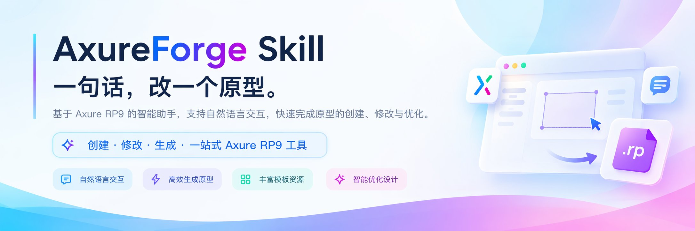

<p align="center">
  <a href="README.md">English</a> · <b>简体中文</b>
</p>

<p align="center">
  
</p>

<h1 align="center">AxureForge Skill</h1>

<p align="center"><b>说一句话，改一个原型。</b></p>
<p align="center">
  用日常语言让 AI 助手分析、新建和修改 Axure RP9/RP11 原型<br>
  不记命令，不碰文件格式。
</p>

<p align="center">
  
  
  
</p>

<p align="center">
  
  
  
  
</p>

<p align="center">
  <a href="#能做什么">能做什么</a> ·
  <a href="#它是怎么工作的">它是怎么工作的</a> ·
  <a href="#安装">安装</a> ·
  <a href="#怎么用">怎么用</a> ·
  <a href="#进阶与可选设置">进阶与可选设置</a> ·
  <a href="#常见问题">常见问题</a>
</p>

## 能做什么

- 🔍 **看懂老原型** —— 一次说清有哪些页面、每页有什么元件、挂了哪些交互。
- 🧱 **从零搭页面** —— 先约定画布，再生成骨架：页面范围、目标端、宽度、首屏高度、是否纵向延展。
- 🌐 **网页转原型** —— 把现成的网页读成可以继续编辑的 RP 文件，另存为新文件。
- ✏️ **批量改文案** —— 比如把页面里的「提交」统一改成「确认提交」，一次提交，改不成功就一条都不留。
- 👆 **配交互** —— 给按钮配「点击切换面板状态」这类动作，并说清挂在哪个元件上。
- 🔄 **RP9 与 RP11 严格转换** —— 先预检再转换，能力不够时如实告诉你，不做隐式转换。
- ✅ **没有编辑器也能生成与校验** —— 装好就能建文件、查结构和属性；只有视觉验收才需要打开 Axure。

## 它是怎么工作的

整个过程分四步，中间的事它来做。

1. **你提需求** —— 用中文说一句就行。
2. **约定页面与画布** —— 新建或大幅改版时，一次确认页面范围、目标端、画布宽度、首屏高度，以及固定高度还是纵向延展；已有约定直接沿用。
3. **生成或修改 .rp** —— 可以套用内置模板起点，由 AxureForge 自动计算布局，并产出计划、索引和报告作为证据。
4. **你在 Axure 里打开验收** —— 看效果，不满意就接着说。

## 使用前准备

- 安装和生成都不要求已安装 Axure 编辑器。
- 只有做原生视觉验收时，才需要打开对应版本的 RP9/RP11 编辑器。
- 不需要另外装运行环境，装好就能用。

当前 skill 版本 0.4.0，协议 v3，要求 CLI 0.4.0 及以上。

## 安装

第一条命令只是看看这个仓库里有什么：

```bash
npx skills add qizhi2design/axure-forge-skill --list
```

第二条命令把 AxureForge 装到你的 AI 助手里：

```bash
npx skills add qizhi2design/axure-forge-skill --skill axure-forge --agent codex --global
```

安装会用到 `npx` 命令。如果提示找不到这个命令，先装一次 npm（npm 官网有安装包）再回来。
所需的程序从公开下载页获取（[axureforge-cli](https://github.com/qizhi2design/axureforge-cli)），不需要登录。

装好以后，在 AI 助手里用 `$axure-forge` 就能唤起它。

## 怎么用

直接用中文说需求就行，不用记命令。

| 你说的话 | 它会做什么 |
| --- | --- |
| `$axure-forge 检查 RP9 环境` | 确认本机的 Axure RP9 能不能配合工作，缺什么会直接说。 |
| `$axure-forge 分析 ./demo.rp 的页面和交互` | 列出有哪些页面、页面上有什么元件、挂了什么交互。 |
| `$axure-forge 将 ./site 转换为 ./demo.rp` | 把网页文件夹读成可编辑的原型，另存为新文件。 |
| `$axure-forge 将 ./demo.rp 中「提交」改为「确认提交」，另存为 ./edited.rp` | 找到文字所在位置，改完另存，原文件不动。 |
| `$axure-forge 创建两个状态的面板，并为按钮添加切换交互` | 新建两状态面板，把按钮接上「点击切换状态」。 |
| `$axure-forge 把 ./demo.rp 转成 RP11，另存为 ./demo-rp11.rp` | 先预检兼容性，再严格转换并另存；原文件不动。 |
| `$axure-forge 用桌面看板模板起一个 1440 宽的原型` | 以看板模板为起点，按约定画布生成新原型。 |

第一次使用会嗅探 RP9/RP11 环境并检查协议 v3 能力，再准备需要的程序。已经装过且版本合适的会直接复用。

## 进阶与可选设置

<details>
<summary><b>画布约定：什么时候要确认，什么时候沿用</b></summary>

新建原型、新增独立页面或大幅调整布局时，需要先约定画布。
一次确认这几件事：页面范围、目标端、画布宽度、首屏高度，以及固定高度还是纵向延展。

只改文字、元件属性或交互时，沿用已有布局，不重新确认。
本次对话或项目里已经确认过的规格，也直接沿用。

信息不够时它会先给具体建议，一次性请你确认；确认前不开工。
CLI 的默认尺寸不算你已确认的尺寸。

约定会记在工作目录的 `design-brief.md`（默认在 `.forge/` 下）。

</details>

<details>
<summary><b>模板起点：3 个内置模板与尺寸</b></summary>

| 模板 | 建议尺寸 | 包含区块 |
| --- | --- | --- |
| 桌面看板 | 1440×900 | 侧栏、关键指标、任务列表、来源分布 |
| 桌面列表与表单 | 1440×900 | 筛选、数据表格、编辑表单 |
| 移动端详情 | 390×844 | 页头、详情卡片、跟进记录、底部操作 |

三个模板默认都是纵向延展，内容超出首屏后往下长。
模板只是起点，不是已经确认的需求；用哪个、改成什么样，都按你的画布约定来。

</details>

<details>
<summary><b>证据链与索引：.forge、dump、batch</b></summary>

工作目录默认是 `.forge/`，可以用 `--work-dir` 换成别的位置。
每次先读其中的 `summary.json`；只有出问题时才细看报告或索引。

`dump` 会完整解析一次项目并生成索引，之后在本地查询，不把整份节点数据灌进对话。

`batch` 是原子提交：一次写完，失败就整体回滚，不保留中间编辑。
新生成的元件可以按前一步的结果引用，接着做下一步修改。

</details>

<details>
<summary><b>版本选择与更新</b></summary>

新建时的默认版本，按这个顺序决定：你明确指定 → 本项目已确认的约定 → 环境嗅探。

嗅探规则：只装了 RP11 时默认 11；只装了 RP9、两者都有、或都没装时默认 9。
两者都有而交付对象又不明确时，会问你一次，并建议 RP9。

已有文件默认保持源格式，不会悄悄换版本；转换必须你明确要求，先预检再严格转换另存。

`doctor.sh` 支持的参数：`--axure-path`、`--format-version 9|11`、`--app-only`、`--check-updates`。

检查更新请用（在 skill 目录下运行）：

```bash
bash skills/axure-forge/scripts/doctor.sh --check-updates
```

装到别处的话，把前面的目录换成你实际的 skill 所在路径。

CLI 的自更新入口还没随发布版提供，所以升级走安装脚本：重跑上面的安装命令即可。
检查不到版本时会直接说明，不会说成「已是最新」。

更多安装选项见 [安装说明](skills/axure-forge/references/installation.md)。

</details>

## 常见问题

<details>
<summary><b>装好了，但 AI 助手里没反应？</b></summary>

先确认是用 `$axure-forge` 唤起它的。第一次运行会嗅探编辑器环境并检查需要的程序，稍等一下。

</details>

<details>
<summary><b>提示找不到 npx 命令？</b></summary>

先装一次 npm（npm 官网有安装包），装好再回来跑安装命令。

</details>

<details>
<summary><b>改动会覆盖原文件吗？</b></summary>

默认另存为新文件，不会覆盖你的原文件。要覆盖必须你明确要求。

</details>

<details>
<summary><b>Axure 没装在默认位置怎么办？</b></summary>

直接告诉它你的安装路径。自动嗅探「应用程序」中的 RP9/RP11，也支持指定自定义位置。

</details>

<details>
<summary><b>能处理 Axure RP9 的文件吗？</b></summary>

能。读取、编辑和保存 RP9；已有文件默认保持源格式，不会顺手换成 RP11。

</details>

<details>
<summary><b>能处理 Axure RP11 的文件吗？</b></summary>

能。读取、编辑和保存 RP11；要换版本时会先预检，再严格转换另存。

</details>

<details>
<summary><b>能不能不装 Axure 就用？</b></summary>

能。安装、生成、修改和结构校验都不需要编辑器。
只有看真实视觉效果和交互时，才需要打开对应版本的 Axure。

</details>

<details>
<summary><b>RP9 和 RP11 怎么选？</b></summary>

看交付对象：团队还在用 RP9 就选 9。两者都有又没明确要求时，默认 9。
已有文件默认保持原格式，不会顺手帮你换版本。

</details>

## 使用提醒

- RP9 文件可以读取、编辑和保存。
- RP11 文件可以读取、编辑和保存。
- 已有文件默认保持源格式；要换版本必须先预检再严格转换，不做隐式转换。
- 修改默认另存为新文件，不会覆盖你的原文件。要覆盖必须你明确要求。
- 自动检查只验证文件结构和属性。交互效果请在 Axure 里实际预览确认。
- 网页转原型不是 100% 还原。浏览器里的脚本和复杂排版可能对不上，转完要自己过一遍。

## 许可证

AxureForge Skill 采用 MIT 许可证，全文见 [LICENSE](LICENSE)。
随包提供的 AxureForge 程序也采用 MIT 许可证。


## 检查和更新

使用 `axure-forge update check` 检查 CLI 和 skill 版本，`axure-forge update all --dry-run` 预览，`axure-forge update all --yes` 执行。断网不影响使用，发布源不可达时保留当前安装；更新 skill 后重新加载。更换发布仓库、镜像及覆盖规则见[安装说明](skills/axure-forge/references/installation.md)。
